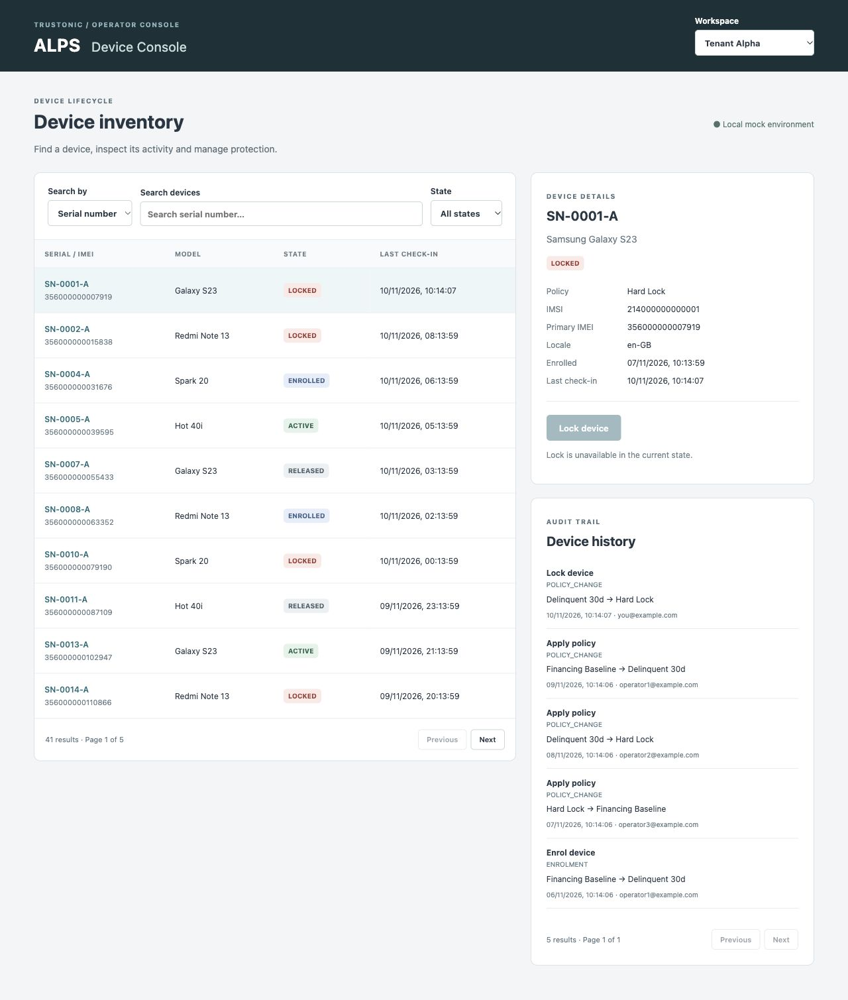
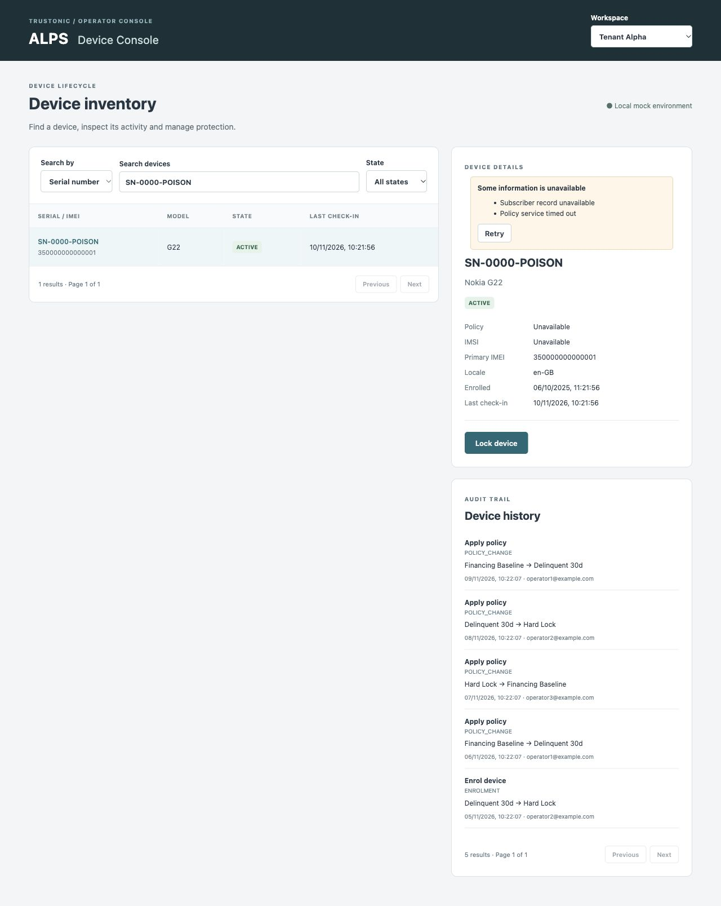

# ALPS Device Console

A local multi-tenant device-management console built with React, TypeScript and Vite. Browse and filter devices, inspect separately fetched details and audit history, and lock a device with optimistic feedback and rollback. The data layer uses plain fetch and custom hooks rather than a data-fetching library.

## Screenshots

### Device inventory, confirmed lock and audit history



### Partial GraphQL response

Usable device details remain visible alongside field-level warnings; unavailable policy and IMSI values do not blank the panel.



## Start locally

Prerequisites: Node.js and npm. Verified with Node **24.22.2**; use that version for a reproducible setup. Dependency installation requires registry access; the application itself needs no backend, API keys or accounts.

```sh
cd /Users/dharnasrivastava/Documents/ChatGPT/alps_front_end
npm ci
npm run dev
```

Open the URL printed by Vite (normally http://127.0.0.1:5173). If that port is occupied, Vite selects another. Choose Tenant Alpha or Tenant Beta, search by serial number or IMEI, and select a device to inspect it. Lock is enabled only when the server supplies an available Lock action.

MSW starts before React renders and intercepts http://localhost:3000/graphql in the browser. All devices and operator emails are synthetic. Reloading reseeds the in-memory mock; nothing persists across reloads. The production build also includes the mock so this exercise can run without a backend.

## Commands

| Command | Purpose |
| --- | --- |
| `npm ci` | Install the exact dependency versions in the lockfile. |
| `npm run dev` | Start the local development server. |
| `npm test` | Run all Vitest tests once. |
| `npm test -- src/api/client.test.tsx` | Run cache and generic-hook contract tests. |
| `npm test -- src/devices/useDeviceLock.test.tsx` | Run optimistic-lock and reconciliation tests. |
| `npm test -- src/devices/Console.test.tsx` | Run console interaction tests. |
| `npm run build` | Typecheck with TypeScript and build static assets into `dist/`. |
| `npm audit` | Inspect current dependency security advisories. |

## Technical architecture

```text
TenantShell → tenant-keyed TenantProvider → Console
                                            ├─ device list
                                            ├─ detail + available actions
                                            ├─ independent history
                                            └─ shared useDeviceLock projection

Views → useTenantQuery / useTenantMutation → custom query / mutation hooks
      → shared request cache (queries only) → fetch → local MSW GraphQL mock
```

| Source | Responsibility |
| --- | --- |
| `src/api/client.ts` | Fetch transport, canonical variables, shared cache, TTL, cancellation and generic hooks. |
| `src/api/operations.ts` | Five named GraphQL documents matching the mock contract. |
| `src/api/types.ts` | Nullable response types for list, detail, history and actions. |
| `src/tenant/TenantContext.tsx` | Tenant context, switcher, tenant lifecycle boundary and injected-variable wrappers. |
| `src/devices/Console.tsx` | Search, filters, pagination, device selection and independent query states. |
| `src/devices/useDeviceLock.ts` | Shared optimistic state, rollback and targeted server reconciliation. |
| `src/mocks/` | Supplied schema, seeded handlers and browser worker bootstrap. |
| `src/test/setup.ts` | MSW Node lifecycle, DOM cleanup and cache isolation between tests. |

The generic hooks preserve the exercise's useQuery/useMutation interfaces. Queries support value-based fetchFirst, merge/replace refetch variables and keyed reset. Mutations bypass the cache, merge/replace variables and optionally throw errors to the caller.

## Race protection and data policy

Each document plus canonically serialized variables has a shared cache entry with an AbortController and generation counter. Cancellation increments the generation before aborting, so even a transport that ignores abort cannot publish its late response. A hook subscribes only to its current effective identity; new search, page, device or tenant variables select a different entry synchronously.

Same-identity refresh keeps existing data with a Refreshing indicator. New identities immediately stop displaying the old identity's data, although a valid same-tenant cache hit for the new identity can render immediately. Variable objects are compared by recursively sorted JSON value, avoiding render loops from object literals.

## Tenant isolation

Tenant wrappers read TenantContext and inject tenantId after all call-site merges, including replacement variables. TenantShell keys its provider subtree by tenant ID, replacing local search, selection, query state and optimistic state together during the tenant-switch render. The module cache retains tenant-partitioned entries until reload; a cache key alone would not clear a selected panel or pending transaction, which is why the keyed subtree is also necessary.

A mutation already sent cannot be undone by aborting a browser request. A detached completion may reconcile only its captured old tenant's cache partition; mounted guards prevent it writing local state after that console unmounts.

## Cache and reset

TTL is 30 seconds from receipt of usable data, including partial successes. This avoids duplicate reads during short navigation while keeping local-console results reasonably current. Expiry revalidates on access rather than on a timer; error-only responses are not treated as fresh data. Identical concurrent consumers share an immediately registered promise and its response.

Full identity includes the document and effective variables. Logical queryKey aliases are separately registered on entries for reset/cancellation. Reset clears all matching entries and aborts their work; consumers sharing the same entry through another alias are notified as well. Unmount only aborts when no consumer remains. There is no eviction or general entity store.

## Optimistic locking and reconciliation

useDeviceLock owns a temporary transaction projection above list and detail. Both views derive the pending state from it; original query payloads stay unchanged, so rejection removes the projection and restores both views. Lock action IDs are read from ListAvailableActions; they are never hardcoded. The action's policy name can be projected, but a policy ID, timestamp or audit event is not fabricated.

Mutations use throwError=true, reject duplicate clicks per device and require assignAction === true for success. A server-confirmed mutation followed by a refresh failure keeps a labelled locked projection with Retry refresh, rather than pretending the action rolled back. An unconfirmed false/missing mutation result is reported as an error and asks the operator to refresh before retrying.

Success invalidates the affected tenant/device detail and all its history pages, plus that tenant's available-actions cache. It fetches authoritative detail and history page 1, then patches matching cached list rows, including the different last-check-in payload shapes. History remounts at page 1 so the new audit entry is visible. List queries are not refetched by lock confirmation.

Do not abort an unrelated in-flight list/search on lock success, since that could leave an empty view. Mark its cache stale and attach a temporary result reconciler so confirmed device fields are applied before that existing request publishes. This callback exists only for the lifetime of the in-flight request and composes if more than one device changes; it is not normalized entity storage. A dedicated test covers the late list response.

Rejected alternatives: separate list/detail optimistic snapshots duplicate rollback logic; full-list refetch violates the requirement; normalized entity storage adds unnecessary scope. Targeted invalidation currently scans the small cache using query document, variables and logical aliases. True generic entity invalidation would need entity-to-query dependency tracking, rather than only document/variables identities.

## Partial data and independent failures

Transport returns data and GraphQL error messages together. The poison device retains its usable detail, renders Unavailable for null policy/IMSI and shows both warnings. List, detail, history and available actions have independent status/retry handling. A history failure does not blank detail. HTTP, network and malformed-envelope failures become query errors; AbortError from intentional cancellation does not become a visible failure.

## Supplied-mock compatibility and limitations

- Schema and browser bootstrap match the pasted Appendix A files. handlers.ts has exactly one type-only change: an explicit response-body generic on the gqlError helper's HttpResponse.json call. This fixes a compile-time incompatibility with current MSW/TypeScript inference without changing runtime behavior. A source comparison verified there are no other handler differences.
- Search uses a Serial number / IMEI selector. The mock combines both fields with AND, so a true cross-field OR search with correct server pagination would need a backend contract change.
- Already-locked devices receive no available Lock action. The normal UI disables Lock; the rollback hook test deliberately rejects a valid action with a test-only MSW override. Production handlers retain the supplied rejection behavior.
- When locking moves a row outside the current state filter, remove it and adjust the known count once. A page can become temporarily short; other affected cached filters/pages are stale for their next visit. Filling the page or fully reconstructing all filtered totals would require a list request. Filtered cache counts without a known row are not guessed.
- No time-based refresh while an untouched page remains open, normalized entities, cache eviction, subscriptions API, focus refetch, retry backoff, persistence, auth, router or Suspense. Minimal rendering notifications are used only for consumers of shared cache entries.
- No mutation cancellation can guarantee server rollback after a request has been sent. No offline mutation queue is attempted.
- Build emits a size warning for the bundled local MSW mock (~610 kB minified); this is expected for this local-only exercise. A production console would remove mock bootstrapping from its deployed build.

## Test cases

Tests use Vitest and React Testing Library in jsdom, with MSW Node request interception. Hook tests use renderHook. Controlled responses and explicit gates make races and mutation failures deterministic; the stale-response test deliberately uses a fetch implementation that ignores abort. Tests clean up rendered components, handlers and cached requests between cases.

### Data-layer contract — 7 tests

Source: `src/api/client.test.tsx`.

1. Canonical serialization ignores object-key order while preserving array order.
2. Identical consumers share one request, retain partial data plus errors and revalidate after TTL expiry.
3. An old response arriving last cannot win, even when transport ignores cancellation.
4. Refetch merges with configured variables by default and supports complete replacement.
5. Reset aborts shared work, clears every consumer and does not automatically restart an unchanged query.
6. Tenant injection overrides forged caller tenant values, including replacement variables.
7. Mutation errors populate errors by default and reject when throwError is enabled.

### Optimistic locking — 5 tests

Source: `src/devices/useDeviceLock.test.tsx`.

1. A rejected mutation restores both optimistic list and detail projections and exposes the error.
2. A successful lock patches the row, confirms detail and refreshes history without another list request.
3. A confirmation-refresh failure preserves a server-confirmed lock and offers refresh recovery.
4. A device leaving a state filter is removed and its count decremented only once.
5. An already-running list response is reconciled before publication without restarting the request.

### Console behavior — 3 tests

Source: `src/devices/Console.test.tsx`.

1. Switching tenant immediately removes previous rows and selected detail.
2. Partial detail and field warnings remain visible alongside an independently failed history request.
3. Pagination uses server counts, disables Next at the last page and resets debounced search to page one.

## Validation and remaining scope

Last implementation validation: **10 November 2026**. All **15 tests across 3 files passed**; TypeScript and Vite build passed; the dependency audit reported zero vulnerabilities at that time. Browser checks confirmed initial inventory, immediate pending lock feedback in both views, server-confirmed state with a new audit entry, tenant-switch clearing and the seeded poison device's partial response. These are recorded results, not a guarantee about future dependency advisories.

The build reports a size warning for the local MSW bundle; see the limitations above. No deployment, exhaustive browser matrix, full accessibility audit or production backend integration was performed.

Potential next steps: backend support for OR search, authoritative filtered-page reconciliation, an entity dependency index if the query surface grows, and broader accessibility/browser coverage.
